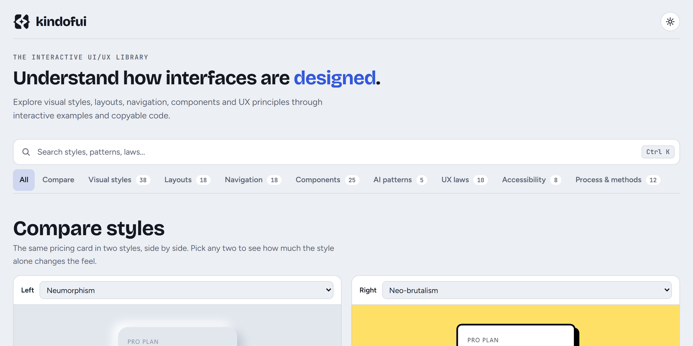
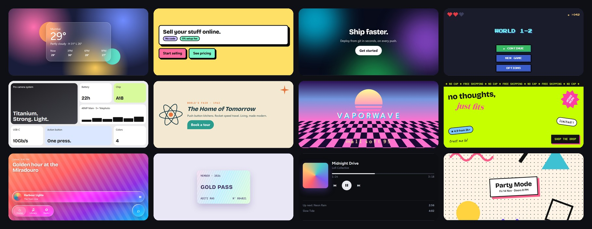
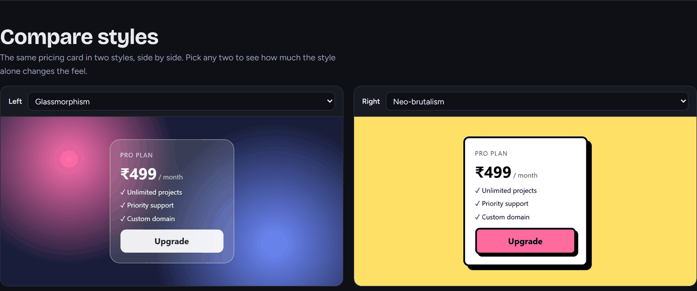
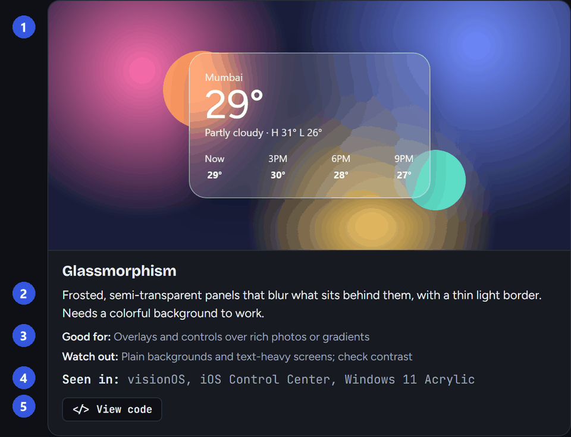
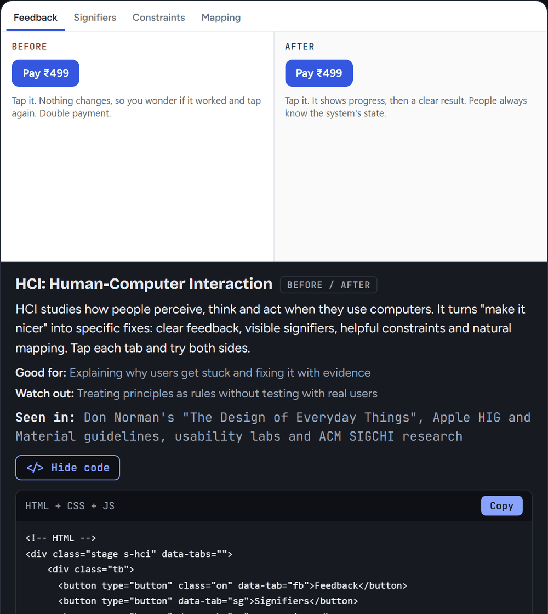
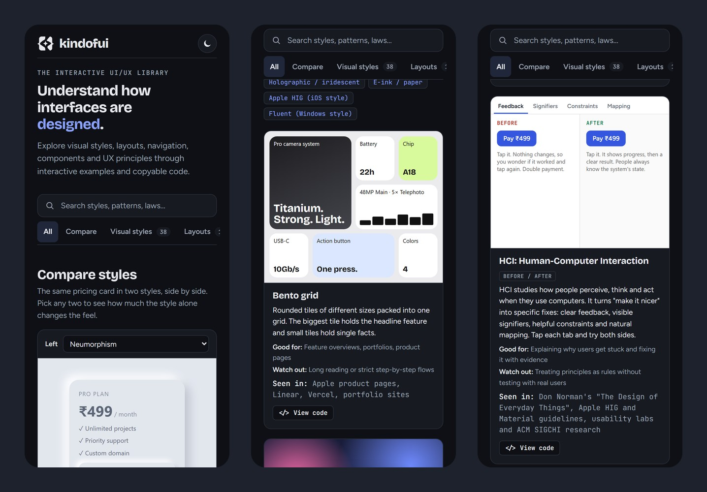

<div align="center">

<picture>
  <source media="(prefers-color-scheme: dark)" srcset="docs/banner-dark.png">
  
</picture>

**Stop looking at screenshots of interfaces. Touch them.**

134 live, clickable, copyable examples of how interfaces are designed, on one page.

[**Open the live site**](https://kindofui.vercel.app) &nbsp;·&nbsp; [Why it exists](#why-this-exists) &nbsp;·&nbsp; [What is inside](#what-is-inside) &nbsp;·&nbsp; [Run it](#run-it) &nbsp;·&nbsp; [Add an entry](#add-an-entry)

</div>

<br>

<picture>
  <source media="(prefers-color-scheme: dark)" srcset="docs/hero-dark.png">
  
</picture>

<br>

## Why this exists

You want to know what glassmorphism is. Or how a command palette should behave. Or why a bigger button is faster to hit.

What you usually get is a **picture** of it, or an article about it, or one style per page behind a menu, or a paid kit. Pictures can't be pressed. You never feel the toggle slide, the skeleton shimmer, the drag snap into place, or see how a "bad" version fails next to a good one. And nothing puts styles, layouts, navigation, components, AI patterns, UX laws, accessibility and design methods **in the same place**, so you can't learn how they connect.

kindofui is the page that did not exist yet:

- **Everything in one scroll.** No page per style, no menus to dig through. Search it, filter it, or just keep going.
- **Every entry is alive.** Hover it, click it, drag it, type into it. Where a lesson is a *comparison* (a UX law, a bad form versus a good one), both sides are on screen and both work.
- **Every entry is the same shape**, so you always know where to look, and you can compare ten styles in the time it takes to read one article.
- **Nothing is locked.** Each demo has a **View code** button with plain HTML, CSS and the little JavaScript it needs, ready to paste into your own project.

It is for people who design or build interfaces and learn by seeing and trying: students, developers who ended up doing UI, designers who want the "why" behind a pattern.

<br>

## What is inside

<picture>
  
</picture>

<sub>Twelve of the 38 visual styles. Every tile on the site is live.</sub>

| Collection | Entries | A taste of it |
|---|---:|---|
| **Visual styles** | 38 | Bento, glassmorphism, neumorphism, neo-brutalism, aurora, vaporwave, liquid glass, 3D tilt, e-ink, Apple and Windows design languages |
| **Layouts** | 18 | Masonry, dashboard, holy grail, 12-column grid, kanban you can drag, carousel, scrollytelling, parallax, scroll-snap sections |
| **Navigation** | 18 | Command palette, mega menu, magnifying dock, speed-dial button, scroll-spy contents, bottom tab bar |
| **Components & UX patterns** | 25 | Skeleton loaders, drag-to-reorder, OTP input, pull to refresh, optimistic updates, form validation, faceted search |
| **AI patterns** | 5 | Prompt box, streaming answer with a stop button, suggestions, citations, voice input |
| **UX laws** | 10 | Fitts's law as a timing game, Hick's law, the Doherty threshold, felt as a 1.5 s response next to one under 400 ms |
| **Accessibility & motion** | 8 | A colour-blindness simulator, focus rings, ARIA, reduced motion, easing curves |
| **Process & methods** | 12 | Personas, journey maps, card sorting, A/B test statistics, design tokens you can switch live |

Plus a **compare tool**: put any two of twelve styles side by side on the *same* pricing card and see how much the style alone changes the feel.

<picture>
  
</picture>

<br>

## The anatomy of an entry

Every one of the 134 follows the same five-part shape:

<table>
<tr>
<td width="55%" valign="top">

</td>
<td valign="top">

1. **A live demo.** Not a screenshot. Click it, scroll it, drag it.
2. **A plain-English description.** One or two sentences, no jargon wall.
3. **Good for / Watch out.** When to use it and when it will hurt you.
4. **Seen in.** Real products that use it, named in text only.
5. **View code.** Copyable HTML and CSS, plus the JavaScript when the demo has any.

</td>
</tr>
</table>

<br>

## Copy the code, for real

The **View code** panel is generated from the page itself, so it can't drift from what you are looking at. The snippet is self-contained: the CSS is scoped to the demo, the JavaScript is wrapped so it can't clash with your page, and the three drag-and-drop demos fetch their one small library themselves.

<picture>
  
</picture>

<br>

## Built to be fast and kind

<picture>
  
</picture>

- **One file.** The whole site is a single HTML file with inline CSS and JavaScript. No framework, no build step, no bundler, no tracking. Two outside dependencies only: web fonts, and SortableJS for the drag demos.
- **Smooth because it is quiet.** Cards that are off screen cost nothing: they are not laid out, painted or animated until you scroll near them. Measured in Chromium: **0.1% CPU while idle**, **steady 60 fps scrolling** across all 134 cards, and on a phone with its CPU throttled to 4× slower it loads in about a second at 0.3% idle CPU. (An earlier build idled at 58% on desktop and 99% on that throttled phone, which is why this matters.)
- **Calm motion.** The hero word moves once, softly, then stops. It gives way the moment you scroll, type or click, and it never moves at all if your system asks for reduced motion.
- **Works on a 320px phone.** Demos size to their card, not the screen. Dark and light themes, remembered between visits.
- **Accessible where it matters.** Keyboard-friendly (`Ctrl`/`⌘` + `K` jumps to search, every scrolling panel can be focused), visible focus, screen-reader labels. The header, toolbar and footer have zero axe-core violations. Some demos *deliberately* show bad examples, so those are not counted.

<br>

## Run it

It is one static file. Either open `ui-style-atlas.html` in a browser, or serve the folder:

```bash
python -m http.server 8791
# then open http://127.0.0.1:8791/ui-style-atlas.html
```

Deploy anywhere that serves static files. On Vercel, `vercel.json` already serves the page at `/`:

```bash
vercel --prod
```

<br>

## Add an entry

Every entry is an `<article>` with the same shape. Drop it into a section, then add its two notes to the map in the script.

```html
<article class="demo" id="unique-id">
  <div class="stage s-xxx"> ...demo markup... </div>
  <div class="meta">
    <h3>Name</h3>
    <p>One or two plain sentences.</p>
    <p class="seen"><b>Seen in:</b> products named in text only</p>
  </div>
</article>
```

Then add `'unique-id': ['Good for ...', 'Watch out ...']` to the notes map.

The rules that keep it working:

- Every stage has a unique `s-xxx` class and **every CSS rule for that demo is scoped under it.** The View code panel finds CSS by that class, including rules inside `@media` and `@container`, and the `@keyframes` they use.
- A demo's JavaScript appears in View code when it refers to the stage's `s-xxx` class or one of its element ids. Put each demo's code under its own `//` comment, or as its own top-level block starting in column 0.
- Stages are a fixed 290px tall and must fit at phone width. Use container queries so a demo reacts to its card, not the screen.
- Example content is invented (names, cities, prices, `example.com`). No real logos, photos or copied text.
- Demos should look like real shipped product UI: restrained colour, SVG icons, terse copy.
- Forms never really submit, and there is no `alert` or `confirm`.

<br>

## Known issues

- Not yet verified in Apple's Safari: `backdrop-filter` on the glass demos. It is declared with the `-webkit-` prefix, and browsers without support get a firmer surface through an `@supports` fallback. The only WebKit available for testing, Playwright on Windows, has no `backdrop-filter`, so the real blur could not be checked there. Everything else renders the same in that WebKit as in Chrome.
- Pull to refresh and swipe cards are tested with real touch input in a mobile-configured Chromium, not on a physical device. A downward drag that starts on the pull-to-refresh card is used for the pull, so it does not scroll the page.
- The three drag-and-drop demos load SortableJS from a CDN, so they need a network connection.

<br>

<div align="center">

Made by **[@xeyynon](https://github.com/xeyynon)** &nbsp;·&nbsp; [Portfolio](https://suryapratik.vercel.app)

</div>
